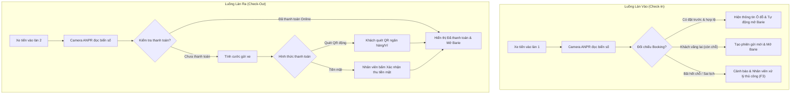

# 📋 KẾ HOẠCH TRIỂN KHAI MÀN HÌNH NHÂN VIÊN TRỰC CỔNG (EMPLOYEE / GATE CONSOLE PLAN)

Tài liệu này đặc tả toàn bộ kiến trúc giao diện, luồng nghiệp vụ và lộ trình triển khai màn hình dành cho **Nhân viên trực cổng / Soát vé (Role: `Staff`)** trong hệ thống bãi đỗ thông minh ParkMaster.

---

## 1. Mục tiêu & Phạm vi Trách nhiệm (Scope & Domain Boundary)

- **Đối tượng sử dụng:** Nhân viên trực trạm soát vé (Gate Operator / Staff).
- **Mục tiêu:** Vận hành luồng xe vào/ra liên tục, đối chiếu lịch đặt trước (Booking), xử lý thu phí tự động/tiền mặt và điều khiển thanh chắn Barie với độ trễ < 0.3s.
- **Ranh giới theo phân công dự án:**
  - **Thuộc phạm vi TV1 (UserService & Security):**
    - Xác thực đăng nhập vai trò `Staff`.
    - Cấp JWT RS256 chứa Claim cô lập dữ liệu: `OwnerProfileId` và `AssignedParkingLotId` ([US-075](file:///d:/project/ParkingManagement/docs/TV1_TASKS.md#L44)).
    - Chặn quyền truy cập chéo sang cổng Owner (`/owner`) hoặc Admin (`/admin`).
    - Lưu vết kiểm toán (Audit Trail) khi nhân viên thực hiện thao tác nhạy cảm (Mở cổng khẩn cấp).
  - **Thuộc phạm vi TV7 (GateService & IoT Hardware):**
    - Xử lý nhận diện biển số ANPR, quét mã QR booking và điều khiển tín hiệu relay đóng/mở Barie.

---

## 2. Kiến trúc Giao diện Màn hình Nhân viên (UI/UX Architecture)

Giao diện được thiết kế chuyên biệt cho màn hình điều khiển tại cabin trực (Console Layout), tối ưu thao tác cảm ứng và phím tắt bàn phím:

```
┌────────────────────────────────────────────────────────────────────────────────────────┐
│  [HEADER CA TRỰC] ParkMaster Console | Bãi: Landmark 81 B2 | NV: Nguyễn Văn A          │
│  Barie Cổng 1: ONLINE (0.18s) | Camera ANPR: REC 60FPS | [F4: Bàn giao / Kết ca]       │
├──────────────────────────────────────────┬─────────────────────────────────────────────┤
│  LÀN VÀO (INBOUND CHECK-IN)              │  LÀN RA (OUTBOUND CHECK-OUT)                │
│  ┌────────────────────────────────────┐  │  ┌───────────────────────────────────────┐  │
│  │ Camera Feed ANPR #01 (Quang học)   │  │  │ Camera Feed ANPR #02 (Quang học)      │  │
│  │ Biển số đọc: [51K-889.32] (99.2%)  │  │  │ Biển số đọc: [51G-774.05] (98.8%)     │  │
│  └────────────────────────────────────┘  │  └───────────────────────────────────────┘  │
│  • Khách hàng: Lê Hoàng Nam (VIP)        │  • Thời gian gửi: 2 giờ 15 phút             │
│  • Vị trí đặt: Ô B-04 (Hầm B2)           │  • Tổng cước: 60.000 VNĐ                    │
│  • Đặt trước: Hợp lệ (còn 8 phút giữ)    │  • Thanh toán: Đã trừ Ví ParkMaster (App)   │
│  ┌────────────────────────────────────┐  │  ┌───────────────────────────────────────┐  │
│  │ [F1: MỞ BARIE VÀO] [Nhập tay F3]   │  │  │ [F2: MỞ BARIE RA] [Thu tiền mặt]      │  │
│  └────────────────────────────────────┘  │  └───────────────────────────────────────┘  │
├──────────────────────────────────────────┴─────────────────────────────────────────────┤
│  [NHẬT KÝ CA TRỰC THỜI GIAN THỰC - LIVE SHIFT AUDIT LOG]                               │
│  08:42:15 | 51K-889.32 | Check-in Vào  | Ô B-04 | Tự động mở Barie ANPR               │
│  08:40:02 | 51A-686.86 | Check-out Ra  | Thu 30K| Đã thanh toán MoMo                  │
│  08:35:10 | 51F-112.33 | Mở thủ công   | Cứu hỏa| Nhân viên mở khẩn cấp (Lý do: PCCC) │
└────────────────────────────────────────────────────────────────────────────────────────┘
```

---

## 3. Luồng Nghiệp vụ Xử lý Xe Vào / Ra (Business Flowchart)



---

## 4. Danh sách Tính năng & Component Cần Triển khai (Frontend Components)

| STT | Component | Vị trí | Mô tả chi tiết |
|:---:|:---|:---|:---|
| 1 | `GateShiftHeader` | Header | Tên bãi đỗ, tên nhân viên, thời gian ca trực, đèn trạng thái kết nối phần cứng và nút kết ca. |
| 2 | `InboundLanePanel` | Cột trái | Khung Camera ANPR vào, kết quả đọc biển số, thông tin ô đỗ đã đặt và nút điều khiển mở barie vào. |
| 3 | `OutboundLanePanel` | Cột phải | Khung Camera ANPR ra, thời gian gửi thực tế, biểu phí tự động, trạng thái thanh toán và nút mở barie ra. |
| 4 | `ManualPlateModal` | Pop-up | Nhập biển số tay hoặc quét mã vé giấy/QR khi camera ANPR bị mờ hoặc không đọc được. |
| 5 | `EmergencyOverrideModal` | Pop-up | Mở barie khẩn cấp (Xe ưu tiên: Cứu hỏa/Cấp cứu/Sự cố). Bắt buộc nhập lý do phục vụ kiểm toán đối soát. |
| 6 | `LiveShiftAuditTable` | Nửa dưới | Bảng nhật ký các lượt xe vào/ra theo thời gian thực trong ca trực hiện tại. |
| 7 | `EndShiftSummaryModal` | Pop-up | Bảng tổng kết số lượt xe, tổng tiền mặt thu được và xác nhận bàn giao ca cho nhân viên tiếp theo. |

---

## 5. Danh sách Phím tắt Tác vụ nhanh (Keyboard Shortcuts)

Để nhân viên thao tác nhanh mà không cần dùng chuột:
- **`F1` hoặc `Phím Space (Làn vào)`**: Mở Barie cho xe vào.
- **`F2` hoặc `Phím Enter (Làn ra)`**: Mở Barie cho xe ra.
- **`F3`**: Bật hộp thoại nhập biển số thủ công.
- **`F4`**: Mở modal kết thúc ca trực / bàn giao.
- **`F9`**: Bật modal mở cổng khẩn cấp (Emergency Override).
- **`Esc`**: Đóng nhanh mọi modal đang mở.

---

## 6. Đặc tả Hợp đồng Dữ liệu & API (API Contracts)

### 6.1. Nhóm Xác thực & Phân quyền (Do TV1 cung cấp)
- **Token Claims bắt buộc đối với Nhân viên:**
  ```json
  {
    "sub": "usr_staff_001",
    "role": "Staff",
    "fullName": "Nguyễn Văn A",
    "OwnerProfileId": "own_012345",
    "AssignedParkingLotId": 1
  }
  ```
- **Ràng buộc:** Nếu nhân viên cố tình thao tác trên bãi khác với `AssignedParkingLotId`, hệ thống từ chối với mã lỗi `403 Forbidden`.

### 6.2. Nhóm Điều khiển Cổng (Giao tiếp TV7 - GateService)
- `POST /api/gate/check-in`: Gửi biển số xe vào bãi, kiểm tra đặt trước và kích hoạt barie mở.
- `POST /api/gate/check-out`: Tính phí xe ra, kiểm tra trạng thái thanh toán và xác nhận xe rời bãi.
- `POST /api/gate/manual-override`: Ghi nhận sự kiện mở barie thủ công / khẩn cấp có lưu vết nhân viên thực hiện.
- `GET /api/gate/shift/current`: Lấy thống kê lượt xe và doanh thu tiền mặt ca trực hiện tại.
- `POST /api/gate/shift/end`: Chốt ca làm việc và xuất biên bản bàn giao.

---

## 7. Lộ trình Triển khai (Implementation Roadmap)

### Giai đoạn 1: Hoàn thiện Giao diện & Mock Interactive trên Frontend (Hiện tại)
- Thiết kế giao diện 2 làn kiểm soát tại [`GateConsolePage.tsx`](file:///d:/project/ParkingManagement/Frontend/ParkingManagement.Web/src/areas/gate/pages/GateConsolePage.tsx) theo chuẩn Dark Mode chuyên nghiệp.
- Tích hợp hệ thống phím tắt nhanh (`F1`, `F2`, `F3`, `F9`).
- Xây dựng modal Nhập tay biển số, Mở cổng khẩn cấp và Kết thúc ca trực.
- Bảng nhật ký sự kiện ca trực cập nhật thời gian thực.

### Giai đoạn 2: Tích hợp Bảo mật & RBAC (Phạm vi TV1)
- Áp dụng [`ProtectedRoute`](file:///d:/project/ParkingManagement/Frontend/ParkingManagement.Web/src/routes/ProtectedRoute.tsx) chỉ cho phép vai trò `Staff` vào route `/gate`.
- Bóc tách claim `AssignedParkingLotId` từ JWT Token và gắn cố định vào Header điều khiển.
- Viết Test tự động xác nhận tài khoản `Driver` hoặc người dùng vãng lai bị chặn truy cập.

### Giai đoạn 3: Kết nối Backend & Hardware (Bàn giao TV7)
- Thay thế mock data bằng API thực tế của `GateService`.
- Kết nối WebSocket/SSE để nhận diện biển số tự động từ Camera ANPR thời gian thực.
- Kiểm thử chế độ ngoại tuyến (Offline Grace Mode) khi mất kết nối mạng.
